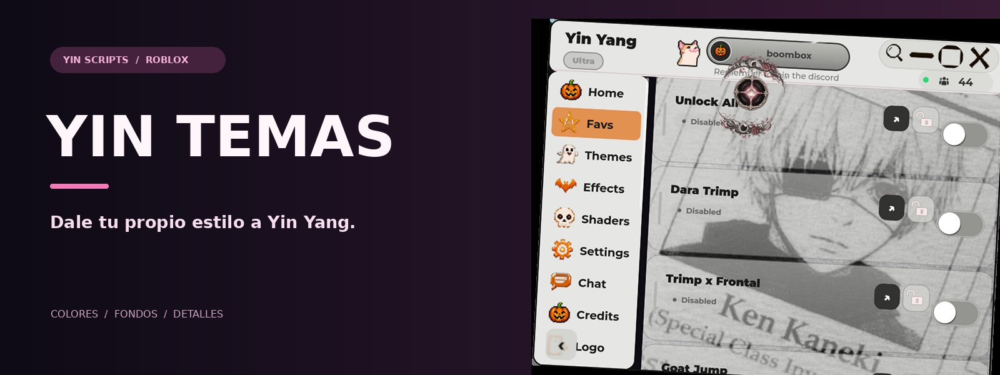
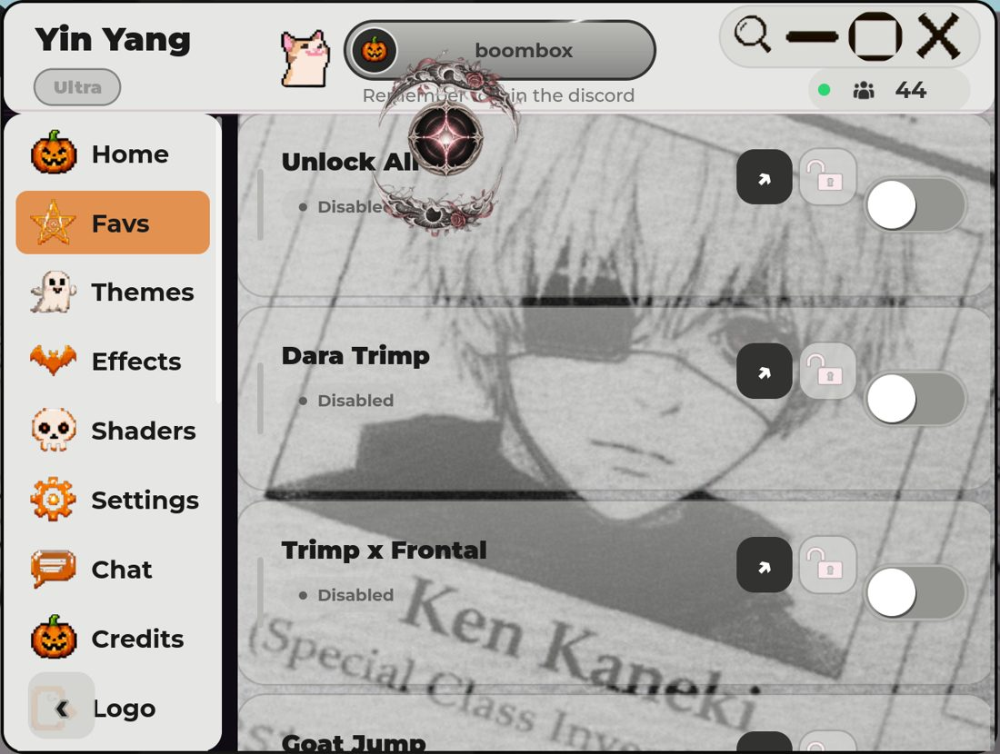
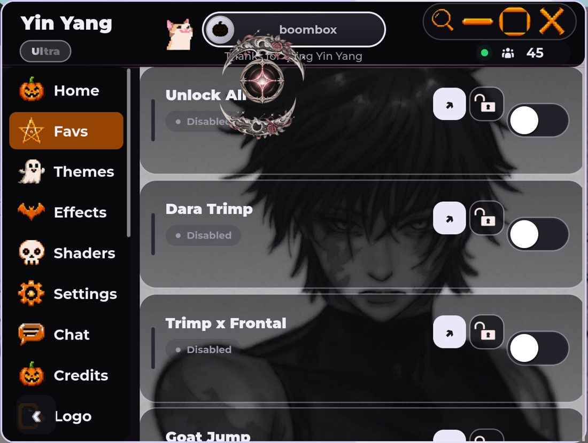
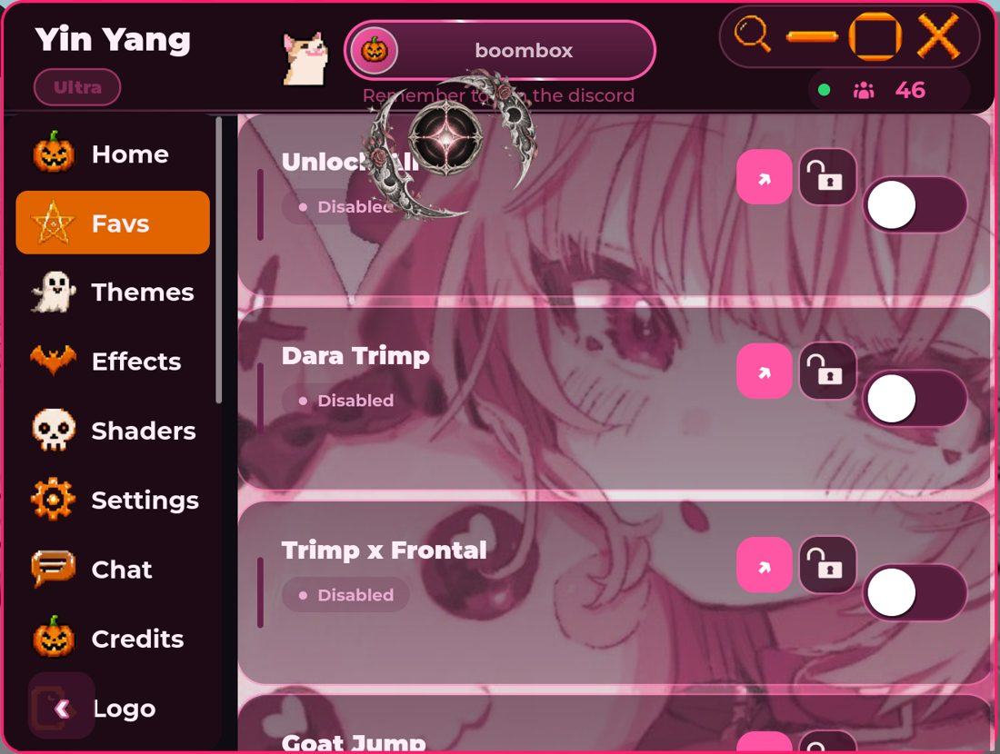
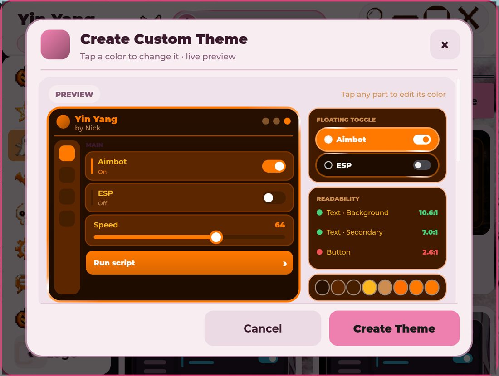

# Yin Temas ✨

**Dale tu propio estilo a Yin Yang.**  
Colores, fondos y detalles para transformar la interfaz.

[Galería](#galería) · [Qué puede cambiar](#qué-puede-cambiar) · [Archivos](#archivos) · [Yin UI](https://github.com/YinScripts/Yin-UI)

---

## Galería

Una mirada a diferentes apariencias de Yin Yang y a su editor de temas:

<table>
<tr><td width="50%"> <b>Claro</b></td><td width="50%"> <b>Oscuro</b></td></tr>
<tr><td width="50%"> <b>Rosa</b></td><td width="50%"> <b>Editor de temas</b></td></tr>
</table>

Las imágenes muestran ejemplos de la interfaz y su personalización; el editor forma parte de Yin Yang.

## Qué puede cambiar

Cada tema puede definir su **paleta de colores** y, según su configuración, agregar imágenes de fondo, iconos, sonidos, efectos y otros detalles visuales. Yin UI carga los temas del catálogo y los integra en la interfaz.

## Archivos

| Archivo | Contenido |
| :--- | :--- |
| [Yin-Temas_v21_Navidad.txt](Yin-Temas_v21_Navidad.txt) | Archivo de temas usado actualmente por Yin UI. |
| [Yin-Temas](Yin-Temas) | Otra versión del catálogo. |

Los archivos contienen las tablas `Themes`, `Order` y `Version`, junto con comentarios sobre sus campos. Al actualizar un catálogo, conserva el formato y aumenta su número de versión como indican sus instrucciones internas.

[Conocer Yin UI →](https://github.com/YinScripts/Yin-UI)

---

Una parte del universo <b>YinScripts</b> ✨

